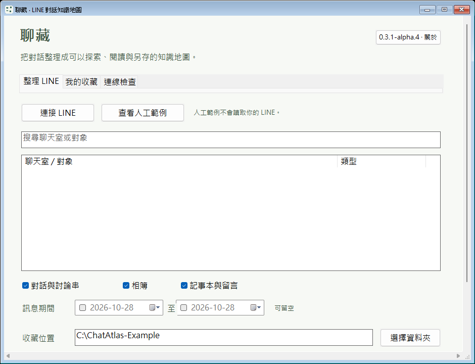
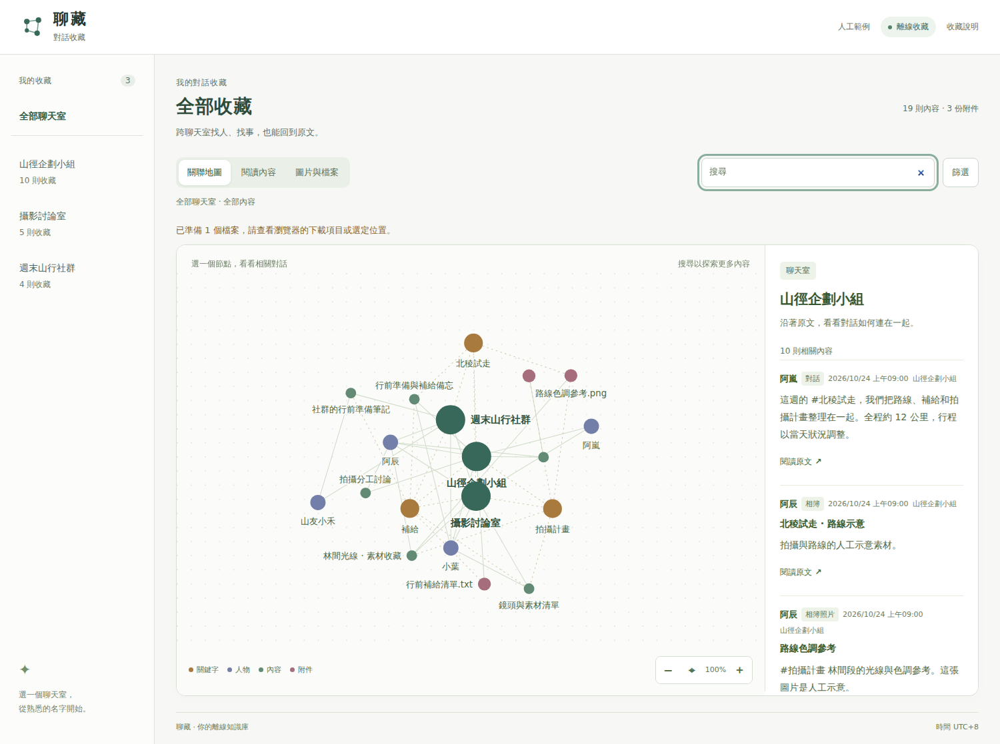

# 聊藏 ChatAtlas

把收藏的對話變成可以探索的地圖。從一個人、一個關鍵字或一份檔案出發，找回相關內容，再回到原文閱讀。

**0.3.1-alpha.4｜Windows x64 可攜預覽版**

> 本版套件僅由通過驗收的 CI 產物發布；是否已可下載，請以本版 Release 頁的實際狀態為準。

[Windows 原生版 ZIP](https://github.com/yung13yubabie/chatatlas-offline/releases/download/v0.3.1-alpha.4/ChatAtlas-0.3.1-alpha.4-Windows-x64-candidate.zip) · [alpha.4 Release、原始碼與校驗檔](https://github.com/yung13yubabie/chatatlas-offline/releases/tag/v0.3.1-alpha.4)

> **真實 LINE 自動採集尚未完成驗收，不是已完成的 LINE 備份工具。**
> 本版沒有隨附已驗證的 LINE 版面設定。可以先看人工範例、探索離線閱讀頁；請勿把範例、啟動畫面或通過 CI 當成真實聊天室已能完整保存的證明。

## 下載後怎麼開

1. 發布完成後，下載 **Windows 原生版 ZIP**，解壓整包到你有權寫入的私人 NTFS 資料夾。
2. 雙擊 `ChatAtlas.exe`。不需安裝 Python、Node.js，也不要求另裝 .NET。
3. 想先試介面，點「查看人工範例」；或直接用瀏覽器開啟包內的 `人工範例/index.html`。
4. 請保留 HTML 旁邊的資料夾，圖片、內容與另存檔案功能會用到它們。

這是原生執行檔，不是套件安裝器；啟動不會下載或安裝開發環境。LINE 連線部分使用 Windows 內建元件。離線閱讀頁使用隨包資源，不依賴 CDN、遠端字型、線上模型或本機伺服器。

**EXE 尚未有 Authenticode 程式碼簽章。** 若系統阻擋，請勿為了使用預覽版停用 SmartScreen、防毒或其他系統保護。

## 可攜資料放在哪裡

本版繼續採用 **EXE 旁的 `ChatAtlasData`**，將程式設定、匯入的連線設定，以及預設收藏和人工範例集中放在一起。

```text
聊藏資料夾/
├─ ChatAtlas.exe
└─ ChatAtlasData/
   ├─ Collections/   預設收藏位置
   └─ Example/       程式建立的人工範例
```

設定檔也放在 `ChatAtlasData` 內；上方只列出主要資料夾。

- **搬移整包：** 先關閉程式，再一起搬走 EXE 與 `ChatAtlasData`。程式資料夾內的收藏使用相對路徑保存，搬家後會從新位置解析。
- **外部收藏仍可使用：** 你明確選定的外部資料夾會保留原本位置，不會因搬動 EXE 而一起搬移。
- **不偷偷換位置：** EXE 所在位置無法安全寫入時，程式會提示並停止，不回退到 AppData 或暫存資料夾。
- **不動舊版資料：** 不會自動搬移或刪除舊 AppData。升級時請保留舊資料；複製與清理應由你確認後進行。

請避免把程式放在唯讀、受保護或多人共用且權限寬鬆的位置。保存位置必須能驗證 Windows 私人 ACL；**不是所有隨身碟格式都適用，FAT32／exFAT 不能當成 NTFS 權限保護的替代品。**

「可攜」指應用程式自己的資料位置，不代表電腦完全不留痕跡。Windows、瀏覽器、防毒及底層元件的暫存或診斷可能留下各自的紀錄，聊藏不會停用或清除它們。

## 畫面預覽

以下是 alpha.4 的實際 CI 執行畫面，原生圖來自實際封裝的 EXE，不是設計稿，也不是替舊圖改標版本。閱讀資料全部是人工範例。

### Windows 原生程式



原生啟動畫面尚未連接 LINE，不等於已完成真實採集。欄位中的 `C:\ChatAtlas-Example` 是避免暴露 CI 帳號路徑的人工輸入，不是預設保存位置；真正預設位置為 EXE 旁的 `ChatAtlasData/Collections`。此 runner 的可用高度較小，因此畫面可捲動；鍵盤移動到下方控制項時也會自動保持可見。

[原生畫面與可攜測試紀錄](https://github.com/yung13yubabie/chatatlas-offline/actions/runs/40659516136) · [離線 HTML 畫面與操作驗收](https://github.com/yung13yubabie/chatatlas-offline/actions/runs/40659395672)

### 離線關聯地圖



- 點人物、關鍵字或附件，看相關內容與原文。
- 切換「閱讀內容」或「圖片與檔案」，不用在地圖裡找每一則訊息。
- 可搜尋、篩選、縮放與拖曳；鍵盤也能切換分頁、移動節點焦點。
- 小螢幕採上下排列，並尊重系統的「減少動態效果」設定。

<details>
<summary>展開閱讀畫面與手機寬度畫面</summary>

### 閱讀內容


### 手機寬度


手機寬度圖僅展示閱讀頁布局，不代表 Windows EXE 可在手機執行，也不是 Android 原生應用程式。

</details>

## alpha.4 更新範圍

- **高 DPI 與小工作區：** 依 DPI 重建字型、控制項與視窗尺寸，處理 DPI 變更；內容放不下時可捲動，鍵盤焦點會保持可見。跨螢幕與不同縮放仍需對實際組合驗收。
- **更清楚的保存位置流程：** 保留 EXE 旁的資料位置。新收藏可在選定父位置下經確認建立私人子資料夾，不會默默修改原資料夾 ACL；不支援的磁碟、連結或同步標記會清楚拒絕。
- **實際目錄身分：** 可攜相對位置及 ZIP 不得放在收藏內的規則，改用經驗證的目錄身分判斷，補大小寫、短檔名及可用時的 subst 測試。
- **有界的另存清理：** 關閉已追蹤的覆寫確認窗後，短時間等待同一母視窗安全回焦；不接受覆寫、不搶焦點、不關閉未知視窗。逾時提示使用者手動取消。
- **資料庫與中止提示：** 查回 SQLite 額外保護能力，舊系統不支援時明確提示；收藏啟動掃描可檢查取消，並保留每個項目的權限與檔案控制代碼驗證。

原有 ZIP64、離線地圖與檔案下載保護繼續保留。沒有因外部報告而放寬雲端同步路徑或新增任意 4 GiB ZIP 上限，也沒有自動修改既有資料夾 ACL。

完整查證差異與限制見 [alpha.4 修正紀錄](docs/ALPHA4_REVIEW.md)；[alpha.3 紀錄](docs/ALPHA3_REVIEW.md)保留作歷史參考。這不是紅隊或相容性認證。

## 驗證狀態

alpha.4 的程式 commit `6a15c4b02282573a699871a79cb3c2ebe29d7cf5` 已通過[來源與介面驗收](https://github.com/yung13yubabie/chatatlas-offline/actions/runs/40659395672)及[實際封裝 EXE 驗收](https://github.com/yung13yubabie/chatatlas-offline/actions/runs/40659516136)，共六個工作成功，亦為上方實際圖片的來源。包含 58 項同程序 Win32 合成 DPI／資料夾流程檢查、實際 Windows 路徑別名驗證與原生產生器的瀏覽器閱讀回歸。合成 DPI 不等於實體多螢幕測試。

文件與四張截圖整合後，最終發布 commit 仍須重新建置與驗收。其 Windows 執行結果、產物 SHA-256 與來源證明，以 alpha.4 Release 的精確紀錄為準。

本版應核對的項目包括：

- Windows 私人 ACL、讀取／鎖檔、原生核心與可攜 GUI；對實際封裝 EXE 驗證啟動與關閉。
- ZIP64 65,536 項、長名稱、4 GiB／uint64 算術邊界及來源增長拒絕。
- 人工 SQLite 與下載器回歸，以及離線 UI 的正常操作與 CSP 外部資源拒絕。
- 發布四個檔案的原始 CI 位元組、`SHA256SUMS.txt` 與 GitHub 建置來源證明。

最終通過、失敗與跳過項目，以本版 [Release](https://github.com/yung13yubabie/chatatlas-offline/releases/tag/v0.3.1-alpha.4) 的精確來源與驗證紀錄為準；不沿用任何前版的 CI 或雜湊。

<details>
<summary>下載後如何核對來源</summary>

請使用 **alpha.4 Release 自己的 `SHA256SUMS.txt`**，核對你下載的檔案；此處不複製會因建置而不同的 ZIP 雜湊，以 Release 隨附檔案為準。

發布完成且有可驗證的來源證明後，使用 GitHub CLI 的開發者可執行：

```sh
gh attestation verify ChatAtlas-0.3.1-alpha.4-Windows-x64-candidate.zip --repo yung13yubabie/chatatlas-offline
```

建置來源證明需核對儲存庫、workflow、來源 commit 及檔案雜湊。它不是 Authenticode 簽章、防毒認證或安全認證。

</details>

## 使用前請知道

- **真實 LINE 自動採集、已驗證的版面設定及多 GB 真實工作負載，仍需另外實機驗收。** 請保留原始資料與第二份副本，不要用預覽版處理唯一一份重要聊天。
- 收藏資料庫、附件及可攜設定**沒有加密或密碼保護**。私人 ACL 不是加密，也不能防止管理員或同一帳號下所有程式讀取資料。
- Authenticode 未簽章、CFG 未啟用；SQLite VFS、祖先目錄替換、rename 及同帳號程序競態沒有宣稱全部消除。
- 特殊或分拆權限的資料夾可能被保守拒絕。短路徑或 `subst` 不受測試環境支援時，必須記為跳過，不能當成已執行通過。
- 瀏覽器的 `file://` 能力會不同。無法使用必要能力時會提示或停止；不繞過安全檢查，也不藉由安裝套件補足功能。
- 關聯地圖協助找回內容，不直接判定人物身分或真實關係。
- 不要把 `ChatAtlasData`、真實聊天、媒體、私人連線設定、資料庫、診斷日誌或憑證放進 Repo、issue 或 Release。分享收藏前，先確認對話與附件的授權及隱私。

受管理 CI 的測試不等於全新 Windows 安裝環境、所有電腦相容性或完整 GUI／LINE 操作已通過。檔案雜湊、PE 匯入表與離線 UI 測試，都不能證明整個程式在任何情況下「100% 安全」、「100% 離線」或「沒有暗門」。

<details>
<summary>大檔與瀏覽器另存的界線</summary>

原生完整封存保留 ZIP64；並未因本輪修改增加 4 GiB 的任意上限。實際可用容量仍受檔案系統、磁碟空間與作業系統影響，不能因此宣稱多 GB 真實工作負載已驗收。

瀏覽器另存有不同能力路徑；Blob 回退路徑保留 64 MiB 限制，並非 ZIP 封存上限。串流下載驗證的是分塊 SHA-256 與總大小，不宣稱另行計算了完整檔案 SHA-256。遇到能力或大小限制時，請依提示停止或改用合適的既有本機操作，不要停用保護。

</details>

## 給開發者

<details>
<summary>原始碼位置、建置與測試</summary>

原生 Windows 程式位於 `native/`，共用閱讀頁位於 `src/line_vault/web/`。舊 Python 實作僅留作歷史來源參考，不會被原生 EXE、CI 或發布管線載入；請勿使用歷史 Python 啟動入口。

建置需要 **Zig 0.14.1**、Node.js；Linux 核心測試另需 GNU C++20、make 與系統 SQLite。以下是開發者操作，**不是使用者開啟 EXE 時會執行的安裝流程**：

```sh
node tools/fetch_zig.mjs
ATLAS_ZIG="$PWD/.toolchains/zig-x86_64-linux-0.14.1/zig" node native/build.mjs
make -C native test build/atlas-cli
node tools/graph_model_test.cjs
node native/tests/windows_bridge_contract.cjs
node tools/check_public_tree.mjs
node tools/package_test.mjs
node tools/package_release.mjs --output dist
```

詳細測試與執行方式見 [原生開發說明](native/README.md)、workflow 及 [alpha.4 修正紀錄](docs/ALPHA4_REVIEW.md)。全部 CI 使用 C++、Node.js 與 PowerShell，不執行 Python。

打包只讀取經檢查的 Git 暫存區白名單，不遞迴複製整個工作目錄。EXE 與執行環境二進位產物放 Release；Repo 截圖只使用已確認的人工資料。`ChatAtlasData` 不得進入公開來源或發布包。

alpha.1 至 alpha.3 已發布的 Release、tag 與檔案保持不變。alpha.4 的來源、截圖及交付紀錄需各自核對；README 後續文件更新不代表重新標記或改動已發布執行檔。

</details>

## 授權與其他說明

[MIT 授權](LICENSE) · [第三方授權清單](THIRD_PARTY_NOTICES.md) · [安全與隱私](SECURITY.md) · [狀態與限制](docs/STATUS.md) · [相容性說明](docs/COMPATIBILITY.md)
