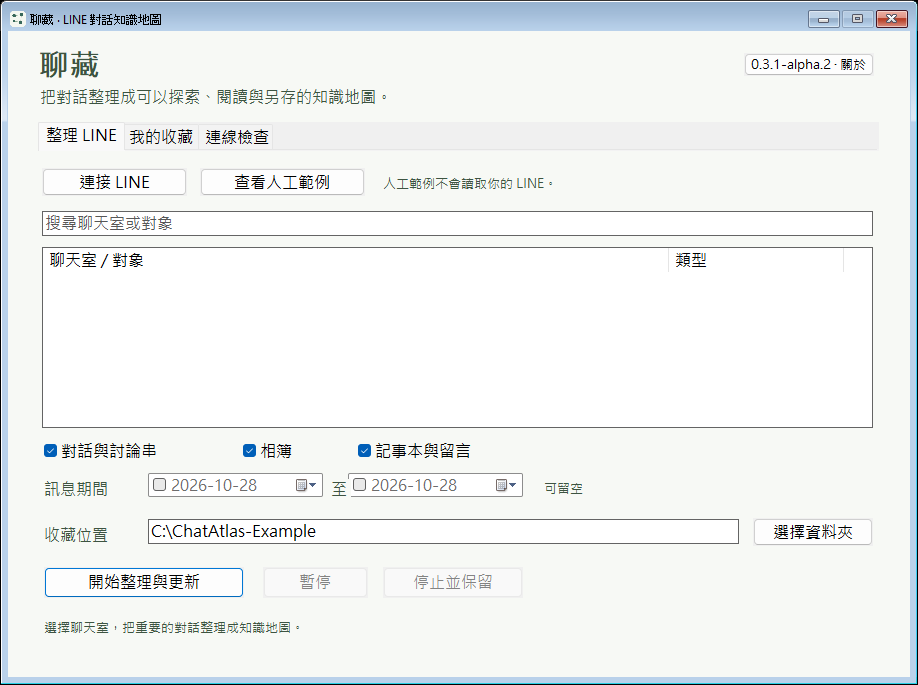
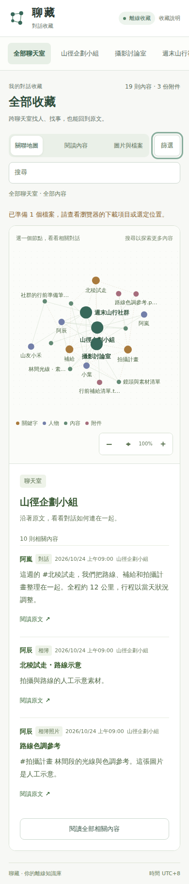

# 聊藏 ChatAtlas

把收藏的對話變成可以探索的地圖。從一個人、一個關鍵字或一份檔案出發，找回相關內容，再回到原文閱讀。

**目前版本：0.3.1-alpha.2｜Windows x64 實驗預覽版**

[下載 Windows 原生版 ZIP](https://github.com/yung13yubabie/chatatlas-offline/releases/download/v0.3.1-alpha.2/ChatAtlas-0.3.1-alpha.2-Windows-x64-candidate.zip) · [本版 Release、原始碼與校驗檔](https://github.com/yung13yubabie/chatatlas-offline/releases/tag/v0.3.1-alpha.2)

> **真實 LINE 自動採集尚未完成驗收，不是已完成的 LINE 備份工具。**
> 本版沒有隨附已驗證的 LINE 版面設定。可以先看人工範例、探索離線閱讀頁；請勿把範例、啟動畫面或通過 CI 當成真實聊天室已能完整保存的證明。

## 下載後怎麼開

1. 下載上方 **Windows 原生版 ZIP**，先解壓整包。
2. 雙擊 `ChatAtlas.exe`。不需安裝 Python、Node.js，也不要求另裝 .NET。
3. 想先試介面，點「查看人工範例」；或直接用瀏覽器開啟包內的 `人工範例/index.html`。
4. 請保留 HTML 旁邊的資料夾，圖片、內容與另存檔案功能會用到它們。

這是原生執行檔，不是套件安裝器；啟動不會下載或安裝開發環境。LINE 連線部分使用 Windows 內建元件。離線閱讀頁使用隨包資源，不依賴 CDN、遠端字型、線上模型或本機伺服器。

**EXE 尚未有 Authenticode 程式碼簽章。** 若系統阻擋，請勿為了使用預覽版停用 SmartScreen、防毒或其他系統保護。

## 真實畫面

以下皆為本版 CI 實際擷取的畫面，不是設計稿；閱讀頁資料是人工範例，不包含真實聊天。

### Windows 原生程式



這張圖顯示原生程式啟動後的介面，**尚未連接 LINE**。它不是成功採集聊天的展示。

[Windows 實際截圖紀錄](https://github.com/yung13yubabie/chatatlas-offline/actions/runs/40632087623)使用已發布、核對 SHA-256 的 alpha.2 EXE；畫面中的資料夾是中性範例輸入，不代表已存在或已完成封存。HTML 圖片取自本版[離線介面驗收](https://github.com/yung13yubabie/chatatlas-offline/actions/runs/40628780990)。

### 離線關聯地圖


- 點人物、關鍵字或附件，看相關內容與原文。
- 切換「閱讀內容」或「圖片與檔案」，不用在地圖裡找每一則訊息。
- 可搜尋、篩選、縮放與拖曳；鍵盤也能切換分頁、移動節點焦點。
- 小螢幕採上下排列，並尊重系統的「減少動態效果」設定。

<details>
<summary>展開閱讀畫面與手機寬度畫面</summary>

### 閱讀內容


### 手機寬度



此圖驗證閱讀頁的窄螢幕布局，不代表 Windows EXE 可在手機執行，也不是 Android 原生應用程式。

</details>

## alpha.2 更新了什麼

- **原生操作更清楚：** 將連接、收藏管理與狀態資訊分開；補上視窗生命週期處理，以及既有收藏資料夾、資料庫與副本操作的檢查。
- **閱讀頁更好用：** 調整字級、對比與層級；加入鍵盤操作、篩選摘要、選取重設與縮放狀態。保留節點位置，避免每次篩選都重新跳動；碰撞標籤會調整位置或隱藏低優先項目，完整名稱仍可查看。
- **封存權限補強：** 新建 Windows 收藏使用私人 ACL；既有收藏及內容若權限過寬，會拒絕繼續，而不是悄悄修改原資料夾權限。新增檔案控制代碼與實際路徑核對，修正 Windows 分隔符號相容問題。
- **LINE 橋接補強：** 核對程序身分、另存對話框與最後寫入位置；內嵌 PowerShell 改由 stdin 傳送，不把整份腳本放在命令列。沒有停用系統記錄。
- **發布流程更可核對：** 全部 CI、原生建置與封裝不執行 Python；Actions 固定完整 commit SHA。發布四個檔案使用 CI 原始產物，附可驗證的 GitHub 建置來源證明。

## 本版實際驗證到哪裡

發布執行檔來自 commit [`e3e332a6792cab1b72882ce4ffe5d011d9aaeb72`](https://github.com/yung13yubabie/chatatlas-offline/commit/e3e332a6792cab1b72882ce4ffe5d011d9aaeb72)。

- [來源與介面檢查](https://github.com/yung13yubabie/chatatlas-offline/actions/runs/40628780990)：原生核心、離線 UI 與瀏覽器測試通過。
- [發布建置與 Windows 驗證](https://github.com/yung13yubabie/chatatlas-offline/actions/runs/40628942352)：包含 123 項原生核心檢查、ACL、UTF-8 橋接，以及**實際封裝 EXE** 的 GUI 啟動、必要控制項與正常關閉測試。
- 離線 UI 測試在涵蓋的地圖、閱讀、檔案、預覽、篩選與另存流程中觀察到 **0 次外部網路請求**；另以獨立測試確認 CSP 拒絕外部 script、圖片、fetch、CSS 與字型。
- [四個發布檔案的建置來源證明](https://github.com/yung13yubabie/chatatlas-offline/attestations/60669107)已驗證儲存庫、workflow、來源 commit 與檔案雜湊。它不是程式碼簽章，也不是安全認證。

這些是在受管理的 CI 環境執行，**不等於全新 Windows 安裝環境、完整 GUI 操作流程、真實 LINE 採集或所有電腦相容性已通過驗收**。PE 匯入表、檔案雜湊及離線閱讀頁測試，也不能證明整個程式在任何情況下「100% 離線」或「沒有暗門」。

<details>
<summary>Windows ZIP 的 SHA-256 與來源核對</summary>

檔案：`ChatAtlas-0.3.1-alpha.2-Windows-x64-candidate.zip`

```text
359ace24635feb7de054898ee0a21d20351e2a730c79f9581c9bbe90772ec8e7
```

其餘檔案請對照 Release 的 `SHA256SUMS.txt`。使用 GitHub CLI 的開發者亦可執行：

```sh
gh attestation verify ChatAtlas-0.3.1-alpha.2-Windows-x64-candidate.zip --repo yung13yubabie/chatatlas-offline
```

SHA-256 用於確認檔案是否相同，不代表防毒認證、安全認證或作者簽章。

</details>

## 使用前請知道

- **真實 LINE 自動採集、已驗證的版面設定與多 GB 附件，仍未完成實機驗收。** 請保留原始資料與第二份副本，不要用預覽版處理唯一一份重要聊天。
- 收藏資料庫及附件**沒有加密或密碼保護**。ACL 是本機存取控制，不是加密，也不能防止管理員或同一帳號下所有程式讀取資料。
- Authenticode 未簽章，CFG 尚未啟用；路徑與 UI 操作競態只做部分防護，不能宣稱全部消除。本版不是完整的獨立安全稽核。
- 關聯地圖是找回內容的工具。相同暱稱、共同關鍵字或圖上的線，不應直接當成人物身分或真實關係的判定。
- 不要把聊天、媒體、私人設定、資料庫、診斷日誌或憑證放進 Repo、issue 或 Release。分享收藏前，先確認對話與附件的授權及隱私。

## 給開發者

<details>
<summary>原始碼位置、建置與測試</summary>

原生 Windows 程式位於 `native/`，共用閱讀頁位於 `src/line_vault/web/`。舊 Python 實作僅留作歷史來源參考，不會被原生 EXE、CI 或發布管線載入；請勿使用歷史 Python 啟動入口。

建置需要 **Zig 0.14.1**、Node.js；Linux 核心測試另需 GNU C++20、make 與系統 SQLite。以下是開發者操作，**不是使用者開啟 EXE 時會執行的安裝流程**：

```sh
node tools/fetch_zig.mjs
ATLAS_ZIG="$PWD/.toolchains/zig-x86_64-linux-0.14.1/zig" node native/build.mjs
make -C native test build/atlas-cli
node tools/graph_model_test.cjs
node native/tests/windows_bridge_contract.cjs
node tools/check_public_tree.mjs
node tools/package_test.mjs
node tools/package_release.mjs --output dist
```

瀏覽器測試使用固定版本 Playwright，詳見 workflow 與 [原生開發說明](native/README.md)。全部 CI 使用 C++、Node.js 與 PowerShell，不執行 Python。

打包只讀取經檢查的 Git 暫存區白名單，不遞迴複製整個工作目錄。EXE 與執行環境二進位產物放 Release，不提交到 Git；Repo 中的 PNG 僅為已確認使用人工資料的文件截圖。

alpha.2 的 Release、tag 與執行檔維持上述 `e3e332a…` 來源不變。之後 `main` 上的 README／截圖更新是文件更新，不會重新標記該版本或改動已發布檔案。

</details>

## 授權與其他說明

[MIT 授權](LICENSE) · [第三方授權清單](THIRD_PARTY_NOTICES.md) · [安全與隱私](SECURITY.md) · [狀態與限制](docs/STATUS.md) · [相容性說明](docs/COMPATIBILITY.md)
