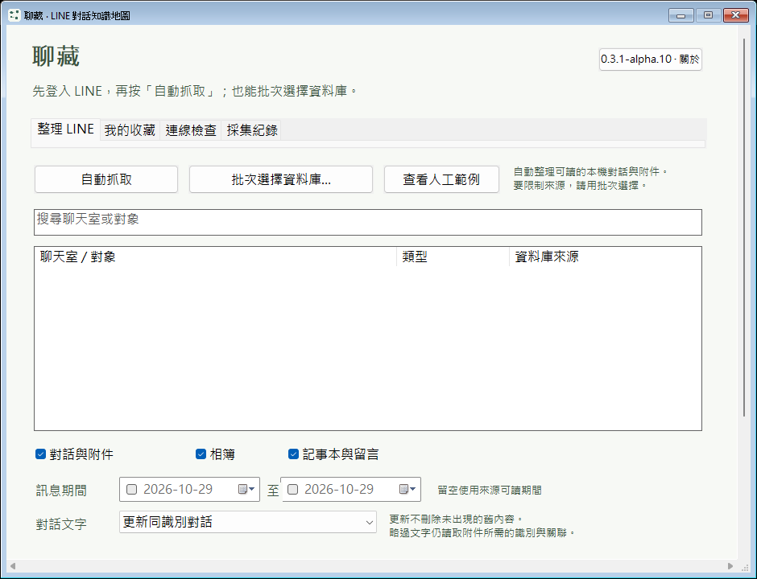
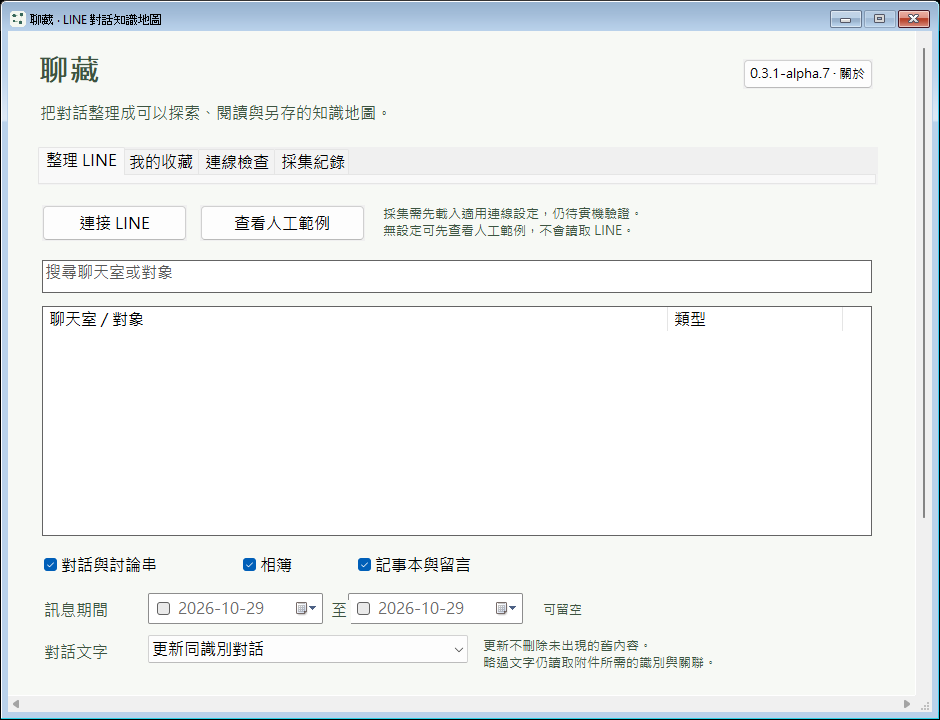
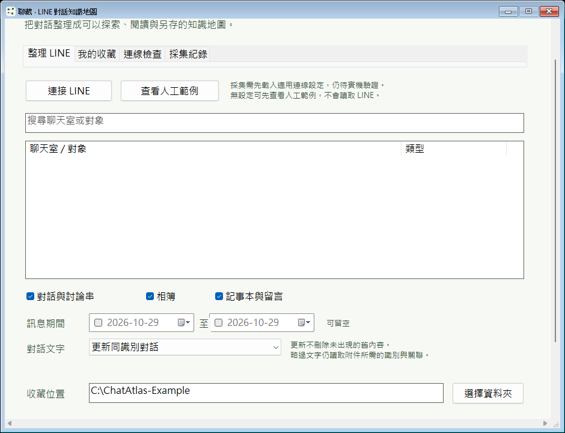
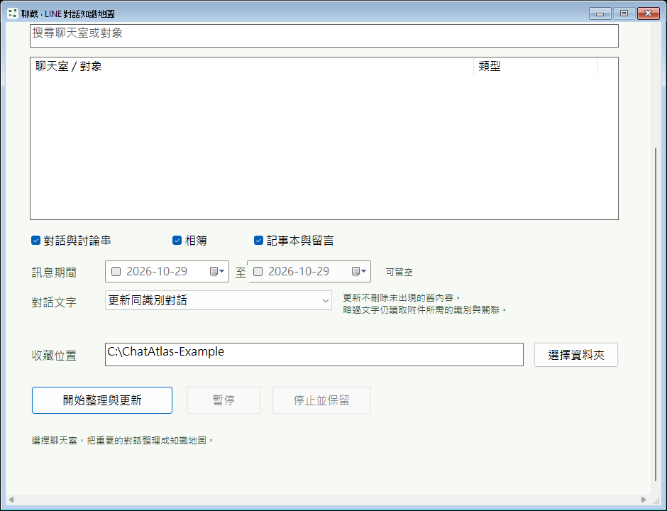
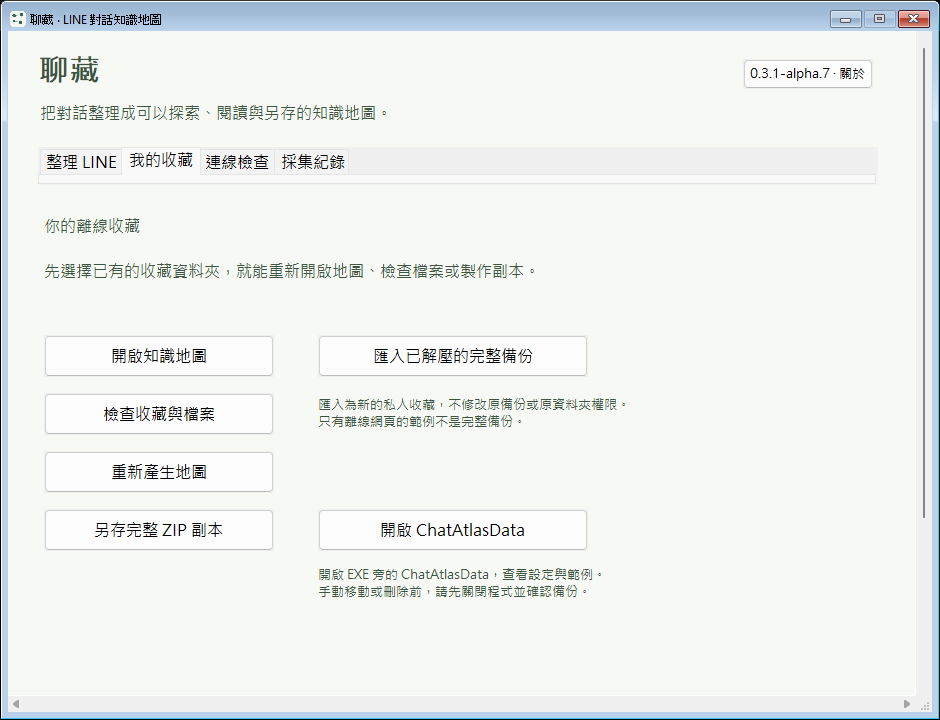
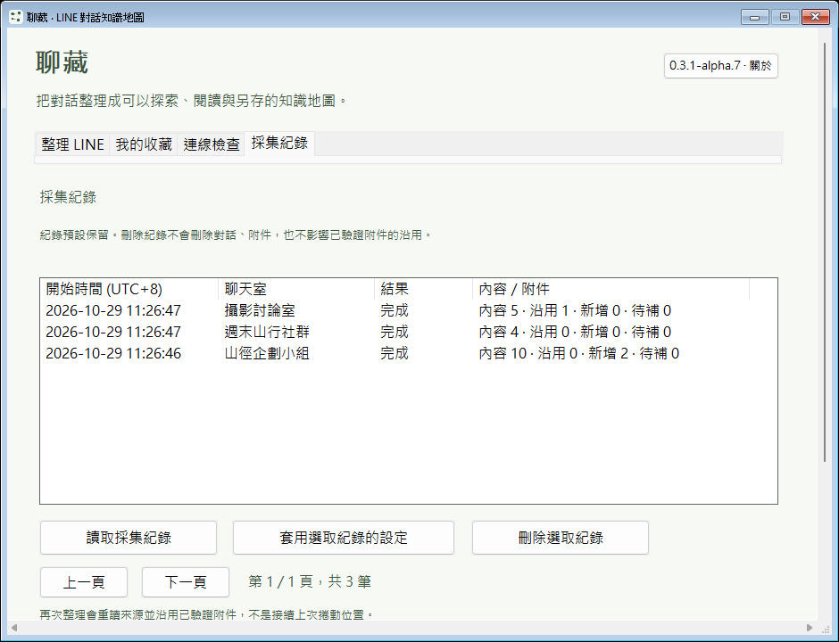
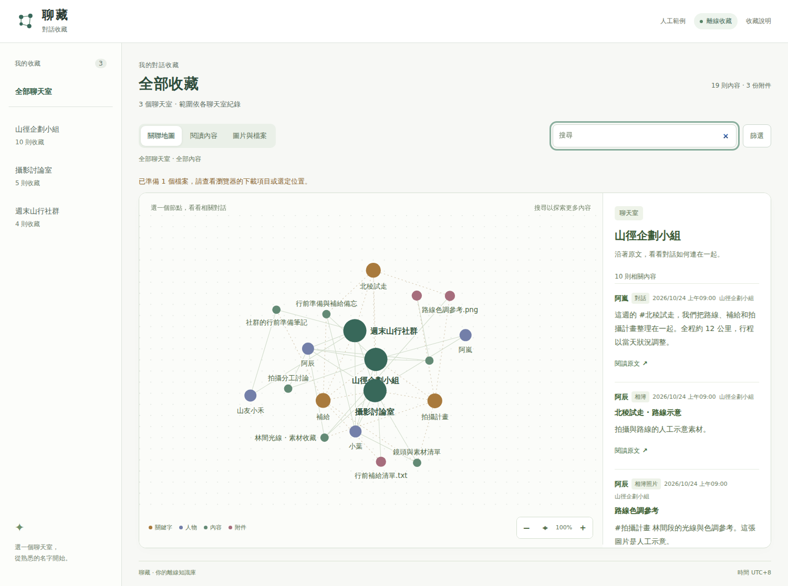
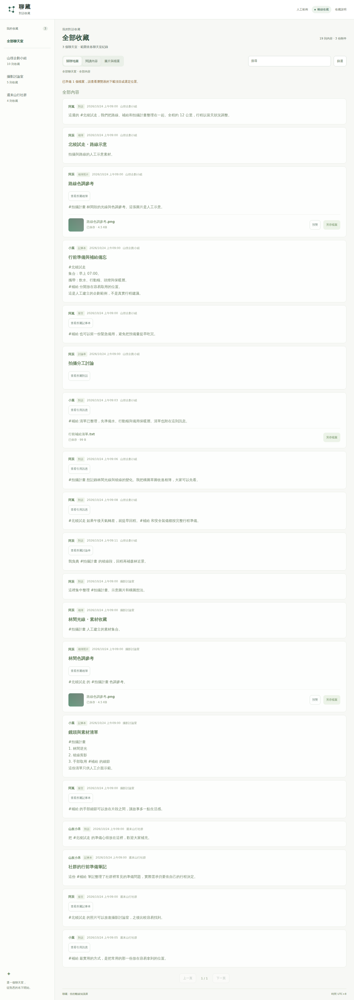
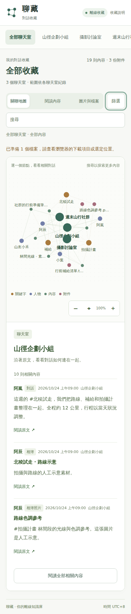

# 聊藏 ChatAtlas

保存 LINE 本機已同步的完整訊息，依聊天室閱讀、查看圖片影片與檔案，或從關聯地圖找回原文。

**0.3.1-alpha.11｜Windows x64 原生訊息工作台**

> alpha.11 已於 2026-10-29 17:35:11 UTC 公開發布為 Windows 預覽版，來源固定為主線提交 [`6e0885ce`](https://github.com/yung13yubabie/chatatlas-offline/commit/6e0885cee9474a3fbd319bcdeb8671ea7f1b5938)。[Source CI](https://github.com/yung13yubabie/chatatlas-offline/actions/runs/40920270807) 三項工作與[正式發布流程](https://github.com/yung13yubabie/chatatlas-offline/actions/runs/40920270757) 四項工作全部成功；五個公開檔案已下載核對大小及 SHA-256。舊版檔案維持不變。

[Windows 原生版 ZIP（建議）](https://github.com/yung13yubabie/chatatlas-offline/releases/download/v0.3.1-alpha.11/ChatAtlas-0.3.1-alpha.11-Windows-x64-candidate.zip) · [單一 EXE](https://github.com/yung13yubabie/chatatlas-offline/releases/download/v0.3.1-alpha.11/ChatAtlas-0.3.1-alpha.11-Windows-x64.exe) · [原始碼 ZIP](https://github.com/yung13yubabie/chatatlas-offline/releases/download/v0.3.1-alpha.11/ChatAtlas-0.3.1-alpha.11-source.zip) · [SHA256SUMS.txt](https://github.com/yung13yubabie/chatatlas-offline/releases/download/v0.3.1-alpha.11/SHA256SUMS.txt) · [alpha.11 Release](https://github.com/yung13yubabie/chatatlas-offline/releases/tag/v0.3.1-alpha.11)

真實 LINE 帳號與媒體相容性仍需實機驗證。本機資料庫能讀取，不代表已同步全部歷史，或每個圖片、影片與檔案都能取回。

## alpha.11 的使用方式

保持 Windows LINE 登入，在「保存設定」確認期間與文字保存方式，再選擇：

- **自動抓取全部：** 尋找常見 LINE 位置的可讀來源，保存全部聊天室在設定期間內可取得的完整訊息，嘗試下載圖片、影片與檔案，再產生 TXT 和離線閱讀頁。不需先找資料庫；這個操作不使用手動勾選，也不會在完成後把清單全部勾上。
- **保存選取的聊天室：** 按「批次選擇資料庫…」，或在檔案視窗以 Ctrl／Shift 多選 `.edb`／`.db`，一次最多 64 份。連接後依名稱、類型及來源搜尋篩選，用「選取本頁」「取消本頁」「選取篩選結果」或「清空所有選取」控制範圍。聊天室分頁顯示，換頁及篩選會保留選取。

EXE 把聊天室、保存結果、連線檢查、抓取紀錄及保存設定分成獨立頁面。保存期間顯示正在處理的聊天室、檔名與步驟；「保存結果」逐檔列出原檔、僅預覽、尚未保存、無法取得或失敗，以及可用的原因，支援搜尋、狀態篩選與分頁。

名稱會優先對應本機可用的聯絡人、本人、聊天室與社群資料。資料裡沒有名稱時會顯示「未命名對話」或「未知成員／名稱待確認」，不再用長識別碼當成名字，也不猜測人名。訊息正文不會因名稱及介面整理而刪減。

「停止並保留」會停止抓取，保留已寫入的訊息及原檔，再整理可再次停止的輕量閱讀頁。此頁可閱讀已保存內容，檔案使用「開啟本機原檔」；瀏覽器可能忽略本機連結的另存檔名，因此不把開啟原檔當成已完成另存。正常完成及手動按「更新離線閱讀頁」都會產生完整閱讀頁，提供經分塊核對、依原名或可讀名稱另存的功能。手動更新只使用已保存資料，不需連接 LINE 或重抓原檔；更新中取消仍保留先前完成的閱讀頁。

離線頁保留「全部聊天室」總覽；個別聊天室的完整訊息、圖片影片與檔案、關聯地圖各有入口，左側清單分頁。這裡的內容是已保存訊息，不是另行挑選的「收藏」。檔案另存優先保留原名，缺名才使用訊息時間與種類；TXT 使用聊天室名稱，同名加短序號。

每個聊天室標示資料庫來源，各來源分開保存。能讀取的資料庫可能是歷史副本，不能據此認定全部屬於目前登入帳號。**LINE 來源資料庫是讀取的檔案；「儲存位置」是聊藏輸出訊息與檔案的資料夾。** 不用建立新的 `.db`，也不要把來源 `.edb` 填進儲存位置。

圖片、影片與檔案使用資料庫內的訊息識別，以及同一個已核對 LINE 程序中實際讀到的登入工作階段嘗試取回。只在 LINE 裡能開啟、尚未另存的內容仍不能保證取得；缺少工作階段、媒體金鑰、授權失效或過期時會列為未取得，縮圖不會當成完整原圖。相簿、記事本及不在本機的對話歷史回補尚未涵蓋。詳見 [LINE 本機資料庫說明](docs/LINE_DATABASE_IMPORT.md) 與 [本輪介面設計依據](docs/UI_DESIGN.md)。

## alpha.11 實際畫面與驗證

四張畫面都對應來源 [`6e0885ce`](https://github.com/yung13yubabie/chatatlas-offline/commit/6e0885cee9474a3fbd319bcdeb8671ea7f1b5938)。兩張 Windows 圖來自[精確封裝 EXE 測試](https://github.com/yung13yubabie/chatatlas-offline/actions/runs/40920270757/job/123619346981)，兩張離線 HTML 圖來自同來源的 [Source CI](https://github.com/yung13yubabie/chatatlas-offline/actions/runs/40920270807)。全部使用人工聊天室、訊息與檔案，沒有使用者聊天照片，不能當成真實 LINE 帳號或媒體取得的實機驗收。


本輪 Linux、Windows、離線瀏覽器及實際封裝 EXE 的操作組全部通過。公開 EXE 與 ZIP 內執行檔位元組相同，來源 ZIP 的 226 個來源檔逐一符合固定提交；公開檔案均沿用本輪 CI 產物，並有[建置來源證明](https://github.com/yung13yubabie/chatatlas-offline/attestations/61409882)。詳見 [alpha.11 核對紀錄](docs/ALPHA11_REVIEW.md)。後續文件與截圖提交不是 EXE 建置來源，也不改動發行 tag。

## 下載後怎麼開

1. 從 Release 下載 Windows 原生版 ZIP，整包解壓到有權寫入的一般本機私人 NTFS 資料夾。
2. 雙擊 `ChatAtlas.exe`。不需安裝 Python、Node.js、MCP、解密套件或 .NET；啟動不會下載開發環境。
3. 登入 Windows LINE，確認「儲存位置」與「保存設定」，按「自動抓取全部」，或連接來源後保存選取的聊天室。
4. 在「保存結果」查看各檔案狀態；按「開啟訊息紀錄」閱讀離線頁。TXT 位於紀錄資料夾內的 `text-exports`，每次匯出建立新批次。
5. 可先按「查看人工範例」，或開啟 ZIP 內的 `人工範例/index.html`。請保留 HTML 旁的資料夾。

單一 EXE 也可放在可寫的一般本機私人資料夾開啟，完整第三方授權告示已內嵌；ZIP 另附人工範例與授權文件。離線頁使用隨包資源，不依賴 CDN、遠端字型、線上模型或本機伺服器。取得 LINE 圖片影片與檔案時可能使用網路，完成後的閱讀頁可離線開啟。

EXE 尚未有 Authenticode 程式碼簽章。若系統阻擋，請勿停用 SmartScreen、防毒或其他系統保護。

## 可攜資料放在哪裡

程式設定、匯入的連線設定、預設訊息紀錄及人工範例集中放在 **EXE 旁的 `ChatAtlasData`**。

```text
聊藏資料夾/
├─ ChatAtlas.exe
└─ ChatAtlasData/
   ├─ Collections/   預設訊息紀錄位置
   └─ Example/       程式建立的人工範例
```

設定檔也放在 `ChatAtlasData` 內；上方只列主要資料夾。

- **搬移整包：** 關閉程式，再一起搬走 EXE 與 `ChatAtlasData`；程式資料夾內的紀錄使用相對路徑，搬移後會從新位置解析。
- **外部資料夾：** 自行選定的外部儲存位置會保留，不隨 EXE 搬移。
- **位置無法寫入：** 程式會提示並停止，不回退到 AppData 或暫存資料夾。
- **舊版資料：** 不自動搬移或刪除舊 AppData；升級時請保留既有資料。

保存位置必須能驗證 Windows 私人 ACL。網路共用、映射網路磁碟、雲端同步或連結位置不支援建立私人資料；FAT32／exFAT 不能代替 NTFS 權限保護。「可攜」指程式自己的資料位置，Windows、瀏覽器及防毒仍可能留下各自的暫存或診斷。

## 歷史版本證據

以下紀錄固定屬於各版的來源與產物，不當作 alpha.11 的驗收。

## alpha.10 已發布驗證

alpha.10 發行來源固定為 [`3ef487ee`](https://github.com/yung13yubabie/chatatlas-offline/commit/3ef487ee17030e387733dfa2a6ff05dd61ab7015)。[Source CI](https://github.com/yung13yubabie/chatatlas-offline/actions/runs/40859729627) 三個工作與[發布流程](https://github.com/yung13yubabie/chatatlas-offline/actions/runs/40859729726) 四個工作全部成功，包含 Windows 的 313 項 UI、39 項批次來源、30 項 TXT 檢查，以及實際封裝 EXE 的啟動與可攜測試。

五個公開產物已讀回核對大小、SHA-256 與[建置來源證明](https://github.com/yung13yubabie/chatatlas-offline/attestations/61253269)；單一 EXE 與 ZIP 內位元組相同，來源 ZIP 逐檔符合發行提交。詳細結果見 [alpha.10 核對紀錄](docs/ALPHA10_REVIEW.md)。後續文件與截圖提交不是 EXE 建置來源，這些人工資料驗證也不代表真實 LINE 帳號已通過實機驗收。

<details>
<summary>alpha.10 原生程式歷史畫面</summary>



此圖來自 alpha.10 發行來源 `3ef487ee` 的 [exact-release-smoke](https://github.com/yung13yubabie/chatatlas-offline/actions/runs/40859729726/job/123408526110)。尚未連接 LINE，不代表新版畫面或真實採集驗收。

</details>

## alpha.9 已發布驗證

alpha.9 發行來源固定為 [`76817ba`](https://github.com/yung13yubabie/chatatlas-offline/commit/76817baab51b7630f3b0cf3313b06451cea9a740)。[Source CI](https://github.com/yung13yubabie/chatatlas-offline/actions/runs/40850573531) 三個工作與[發布流程](https://github.com/yung13yubabie/chatatlas-offline/actions/runs/40850573625) 四個工作全部成功，包含 Windows 的 40 項候選尋找、216 項 UI 檢查，以及實際封裝 EXE 的啟動與可攜測試。

五個公開產物已讀回核對大小、SHA-256 與[建置來源證明](https://github.com/yung13yubabie/chatatlas-offline/attestations/61229084)；單一 EXE 與 ZIP 內位元組相同，來源 ZIP 逐檔符合發行提交。詳見 [alpha.9 核對紀錄](docs/ALPHA9_REVIEW.md)。後續文件提交不是 EXE 建置來源，這些人工資料驗證也不代表真實 LINE 帳號已通過實機驗收。

## alpha.8 已發布驗證

alpha.8 發行來源固定為主線合併提交 [`89485b19`](https://github.com/yung13yubabie/chatatlas-offline/commit/89485b19d0de2398c179ba323e810c6031380b41)。[Source CI](https://github.com/yung13yubabie/chatatlas-offline/actions/runs/40838414962) 的 Linux、Windows 與瀏覽器工作，以及[發布流程](https://github.com/yung13yubabie/chatatlas-offline/actions/runs/40838414912) 的四個工作皆已通過，包含實際封裝 EXE 的 Windows 啟動、關閉及可攜測試。

Release 只使用該輪 CI 的五個原始產物，發布後已從公開下載網址讀回核對大小與 SHA-256；單一 EXE 與 ZIP 內的執行檔位元組相同。[建置來源證明](https://github.com/yung13yubabie/chatatlas-offline/attestations/61192083) 已逐檔驗證指向同一發行來源。詳見 [alpha.8 核對紀錄](docs/ALPHA8_REVIEW.md)。

後續文件更新不會改動這個 tag 或已發布檔案；文件提交不是 EXE 的建置來源。這些驗證使用人工資料，不代表已通過真實 LINE 帳號驗收。

<details>
<summary>alpha.7 與更早版本的畫面及發布紀錄</summary>

以下保留 alpha.7 發布時的畫面、來源與驗證紀錄，不代表 alpha.8 之後的新按鈕或原生資料庫實機結果。

## 畫面預覽

以下是 alpha.7 程式來源 `04c97fecde52a12d653b8530b742ebe8b2b3a378` 的實際執行畫面。原生圖來自 Native CI 的 `exact-release-smoke` 工作，以 `ATLAS_QA` 啟用測試流程，執行實際封裝的 EXE；離線 HTML 圖來自同一來源的瀏覽器測試。全部使用人工資料，不是設計稿或真實 LINE 採集證明。

### Windows 原生程式



原生啟動畫面尚未連接 LINE，不等於已完成真實採集。真正預設保存位置為 EXE 旁的 `ChatAtlasData/Collections`。圖中的 `C:\ChatAtlas-Example` 是 `ATLAS_QA` 人工示範路徑，不是實際預設值。此 runner 的可用高度較小，因此畫面可捲動；鍵盤移動到下方控制項時也會自動保持可見。

[原生畫面與可攜測試紀錄](https://github.com/yung13yubabie/chatatlas-offline/actions/runs/40810609603) · [離線 HTML 畫面與操作驗收](https://github.com/yung13yubabie/chatatlas-offline/actions/runs/40810537537)

<details>
<summary>展開捲動及收藏管理的實際畫面</summary>







本輪頂端與捲回頂端的截圖位元組相同，中段與底部未見文字互蓋。這些圖片由真實視窗的 `PrintWindow` 取得，會觸發重繪，不能單憑圖片保證所有顯示卡、桌面合成與多螢幕情境皆無殘影。收藏頁頂端圖未涵蓋下方所有控制項，仍可向下捲動。

</details>

### 採集紀錄



測試透過實際視窗控制項選取人工收藏、切換採集紀錄分頁並讀取三筆 UTC+8 紀錄，不是把文字貼到畫面。這證明人工收藏的紀錄動線，不代表已連接真實 LINE。

### 離線關聯地圖



- 點人物、關鍵字或附件，看相關內容與原文。
- 切換「閱讀內容」或「圖片與檔案」，不用在地圖裡找每一則訊息。
- 可搜尋、篩選、縮放與拖曳；鍵盤也能切換分頁、移動節點焦點。
- 小螢幕採上下排列，並尊重系統的「減少動態效果」設定。

<details>
<summary>展開閱讀畫面與手機寬度畫面</summary>

### 閱讀內容



### 手機寬度



手機寬度圖僅展示關聯地圖與內容區布局，不代表 Windows EXE 可在手機執行，也不是 Android 原生應用程式。

</details>

## alpha.7 更新範圍

- **本機私人保存位置：** 建立私人目錄、鎖檔與檔案前拒絕網路共用與網路磁碟，包括啟動、收藏、匯入目的地及 ZIP 匯出。仍保留原有私人 ACL／連結防護，不改既有共用資料夾的權限，也不自動修復或刪除舊版留下的目錄。
- **視窗與資料管理：** 整批移動控制項後統一重繪；新增「開啟 ChatAtlasData」，只開啟資料目錄，不代為刪除內容。採集紀錄改以 UTC+8 顯示，資料庫仍保存原始 UTC。
- **連線提示：** 分開「找不到 LINE 主視窗」與「找到多個視窗」；未載入版面設定時只做辨識，載入設定亦不等於已通過真實採集驗證。
- **環境指引：** 雲端同步／重解析點仍保守拒絕，指引改放一般本機目錄，不把所有重解析點都稱為 OneDrive。
- **同範疇旁支：** 再次連線檢查失敗或取消時不再保留舊診斷報告；時間轉成 UTC 後超出既有 1970–2999 年範圍會明確拒絕；延伸 Windows 路徑的正規化與父層走訪保留磁碟／共用根界線，不放寬網路私人保存政策。
- 詳見 [alpha.7 核對紀錄](docs/ALPHA7_REVIEW.md)。

### 保留的 alpha.6 修正

- **附件儲存路徑一致性：** 登記、沿用、完整性檢查與下載分塊共用既有匯入的路徑規則；ZIP 寫入前另核對資產名稱與實際內容雜湊；不合規的中繼資料明確拒絕，不自動搬動、刪除或改名舊檔。
- **先核對再修正：** alpha.5 的匯入白名單與重複匯入自動編號已存在，本版沒有重寫這兩條正常動線。詳見 [alpha.6 核對紀錄](docs/ALPHA6_REVIEW.md)。
- **不是防毒功能：** `.bin` 可以保存任意附件位元組；另存時可能保留原始副檔名，請勿執行不可信附件。

### 保留的 alpha.5 功能

- **採集紀錄：** 查看已結束或中斷的整理工作，保留或刪除歷史列。刪紀錄不刪聊天與附件，也不清除去重索引；可套用舊選項後再自行開始。
- **對話文字保存模式：** 可更新同識別的對話，或不保存新對話文字。後者適用於 message／thread，保留附件必要的最小關聯，離線頁標示「未保存對話文字」；已選取的記事本、留言等其他分類仍按原選項處理，不代表完全不讀取文字，也不是另有「只存文字、不下載附件」開關。再次整理會校驗既有完整附件，而非只憑檔名跳過。
- **匯入完整備份：** 將已解壓、含資料庫的完整備份複製成新的私人收藏，不更動來源內容或權限；閱讀頁使用本版可信資源重建。包內 HTML-only 人工範例不是可續抓的資料庫備份。
- **取消、停止與狀態：** 取消建立收藏不再提前保存偏好；停止採集不再自動接著重建整份網頁。離線頁顯示已知採集範圍、狀態和待補原因，不把「完成」當成全部歷史都已保存。

舊版收藏管理前會明確詢問格式升級，先在私人收藏內保存獨立資料庫還原副本，再以交易更新格式。升級後 alpha.4 與更早版本不能管理這份收藏；副本不等於附件的第二份備份，升級前仍請保留完整原始副本。

完整 ZIP 仍要求附件已完整保存；本輪沒有加入部分備份格式。真實 LINE 版面設定及採集仍未驗收，不能把人工測試的去重、重試或歷史功能視為真實 LINE 已可用。

前版報告經核對後，只有取消偏好與完整備份匯入缺口需處理；「預建 Collections」及「每個 ZIP 成員都刷磁碟」不符合 alpha.4 發布原碼，沒有為此修改。詳見 [alpha.5 核對與限制](docs/ALPHA5_REVIEW.md)；[alpha.4 紀錄](docs/ALPHA4_REVIEW.md)保留作歷史參考。

## 驗證狀態

程式來源 `04c97fec` 的 [Source CI](https://github.com/yung13yubabie/chatatlas-offline/actions/runs/40810537537) 與 [Native CI](https://github.com/yung13yubabie/chatatlas-offline/actions/runs/40810609603) 各三個工作全部成功，包含 Windows 合成控制項測試及實際封裝 EXE 的啟動、範例、可攜位置與關閉驗證。上方圖片固定來自這個來源；後續文件提交不冒充圖片來源。

最終發布還會對包含文件的來源重跑完整 CI，僅採用該次原始四個產物，不重新打包；最終提交、CI 與來源證明請見 Release。

本輪程式驗證與發布核對範圍：

- Windows 私人 ACL、讀取／鎖檔、原生核心與可攜 GUI；對實際封裝 EXE 驗證啟動與關閉。
- ZIP64 65,536 項、長名稱、4 GiB／uint64 算術邊界及來源增長拒絕。
- 人工 SQLite 與下載器回歸，以及離線 UI 的正常操作與 CSP 外部資源拒絕。
- 發布四個檔案的原始 CI 位元組、`SHA256SUMS.txt` 與 GitHub 建置來源證明。

最終通過、失敗與跳過項目，以本版 [Release](https://github.com/yung13yubabie/chatatlas-offline/releases/tag/v0.3.1-alpha.7) 的精確來源與驗證紀錄為準；不沿用任何前版的 CI 或雜湊。

<details>
<summary>下載後如何核對來源</summary>

請使用 **alpha.7 Release 自己的 `SHA256SUMS.txt`**，核對你下載的檔案；此處不複製會因建置而不同的 ZIP 雜湊，以 Release 隨附檔案為準。

發布完成且有可驗證的來源證明後，使用 GitHub CLI 的開發者可執行：

```sh
gh attestation verify ChatAtlas-0.3.1-alpha.7-Windows-x64-candidate.zip --repo yung13yubabie/chatatlas-offline
```

建置來源證明需核對儲存庫、workflow、來源 commit 及檔案雜湊。它不是 Authenticode 簽章、防毒認證或安全認證。

</details>

</details>

## 使用前請知道

- **真實 LINE 自動採集、已驗證的版面設定及多 GB 真實工作負載，仍需另外實機驗收。** 請保留原始資料與第二份副本，不要用預覽版處理唯一一份重要聊天。
- 訊息資料庫、圖片影片檔案及可攜設定**沒有加密或密碼保護**。私人 ACL 不是加密，也不能防止管理員或同一帳號下所有程式讀取資料。
- Authenticode 未簽章、CFG 未啟用；SQLite VFS、祖先目錄替換、rename 及同帳號程序競態沒有宣稱全部消除。
- 特殊或分拆權限的資料夾可能被保守拒絕。短路徑或 `subst` 不受測試環境支援時，必須記為跳過，不能當成已執行通過。
- 瀏覽器的 `file://` 能力會不同。無法使用必要能力時會提示或停止；不繞過安全檢查，也不藉由安裝套件補足功能。
- 關聯地圖協助找回內容，不直接判定人物身分或真實關係。
- 不要把 `ChatAtlasData`、真實聊天、媒體、私人連線設定、資料庫、診斷日誌或憑證放進 Repo、issue 或 Release。分享訊息紀錄前，先確認對話與檔案的授權及隱私。

受管理 CI 的測試不等於全新 Windows 安裝環境、所有電腦相容性或完整 GUI／LINE 操作已通過。檔案雜湊、PE 匯入表與離線 UI 測試，都不能證明整個程式在任何情況下「100% 安全」、「100% 離線」或「沒有暗門」。

<details>
<summary>大檔與瀏覽器另存的界線</summary>

原生完整封存保留 ZIP64；並未因本輪修改增加 4 GiB 的任意上限。實際可用容量仍受檔案系統、磁碟空間與作業系統影響，不能因此宣稱多 GB 真實工作負載已驗收。

瀏覽器另存有不同能力路徑；Blob 回退路徑保留 64 MiB 限制，並非 ZIP 封存上限。串流下載驗證的是分塊 SHA-256 與總大小，不宣稱另行計算了完整檔案 SHA-256。遇到能力或大小限制時，請依提示停止或改用合適的既有本機操作，不要停用保護。

</details>

## 給開發者

<details>
<summary>原始碼位置、建置與測試</summary>

原生 Windows 程式位於 `native/`，共用閱讀頁位於 `src/line_vault/web/`。舊 Python 啟動入口、實作、測試與建置工具已移除；原生 EXE、CI 與發布管線均不執行 Python。LINE 本機來源現在由 C++ 直接讀取加密資料庫，沒有 Python 或 JSON 匯出橋接步驟。

建置需要 **Zig 0.14.1**、Node.js；Linux 核心測試另需 GNU C++20、make 與系統 SQLite。以下是開發者操作，**不是使用者開啟 EXE 時會執行的安裝流程**：

```sh
node tools/fetch_zig.mjs
node tools/fetch_line_cipher.mjs
ATLAS_ZIG="$PWD/.toolchains/zig-x86_64-linux-0.14.1/zig" node native/build.mjs
make -C native test build/atlas-cli
node tools/graph_model_test.cjs
node native/tests/windows_bridge_contract.cjs
node tools/check_public_tree.mjs
node tools/package_test.mjs
node tools/package_release.mjs --output dist
```

詳細測試與執行方式見 [原生開發說明](native/README.md)、workflow 及 [alpha.9 核對紀錄](docs/ALPHA9_REVIEW.md)。CI、原生建置與測試使用 C／C++、Node.js 及 PowerShell，不執行 Python。資料庫測試使用人工加密來源，不讀取真實 LINE。

打包只讀取經檢查的 Git 暫存區白名單，不遞迴複製整個工作目錄。EXE 與執行環境二進位產物放 Release；Repo 截圖只使用已確認的人工資料。`ChatAtlasData` 不得進入公開來源或發布包。

alpha.1 至 alpha.8 已發布的 Release、tag 與檔案保持不變。各版的來源、截圖及交付紀錄需各自核對；README 後續文件更新不代表重新標記或改動已發布執行檔。

</details>

## 授權與其他說明

[MIT 授權](LICENSE) · [第三方授權清單](THIRD_PARTY_NOTICES.md) · [安全與隱私](SECURITY.md) · [狀態與限制](docs/STATUS.md) · [相容性說明](docs/COMPATIBILITY.md)
