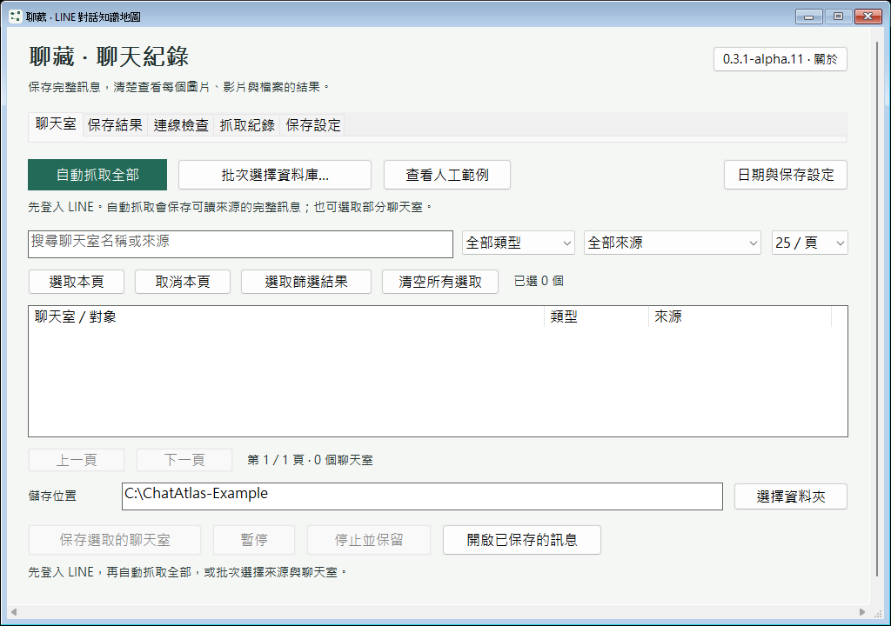
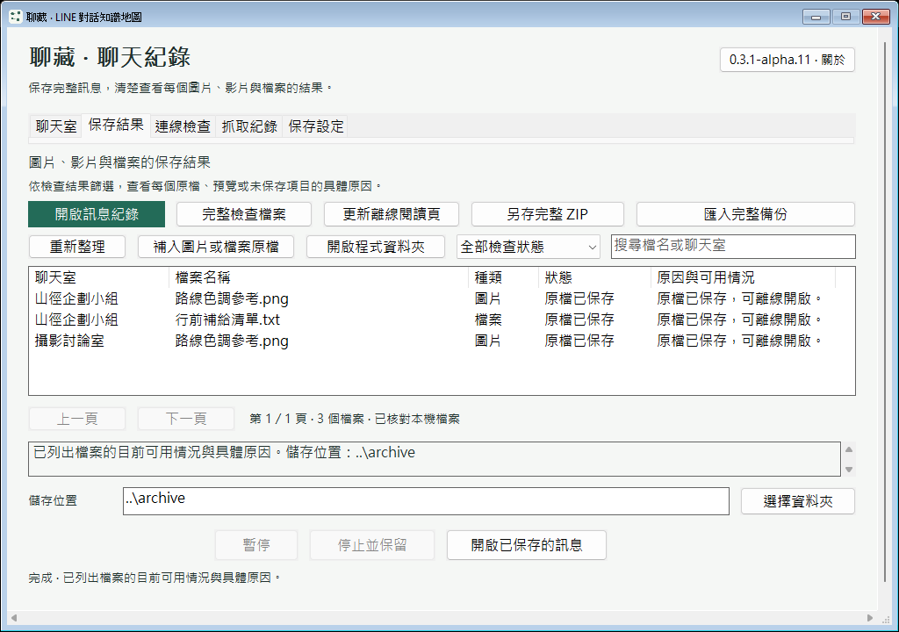
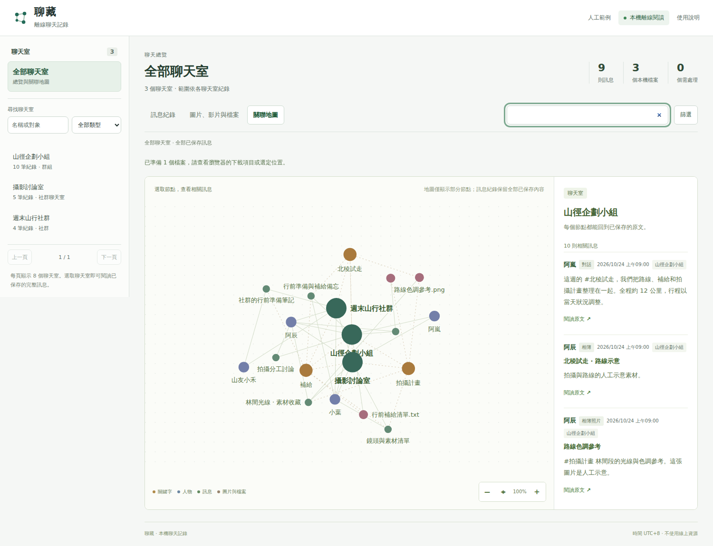
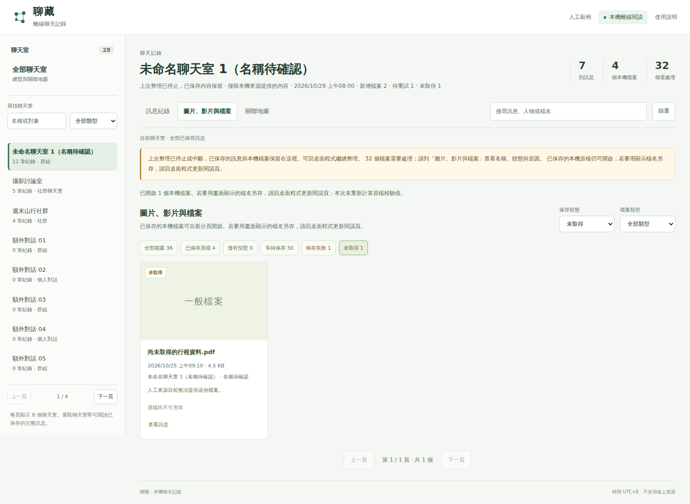

# alpha.11 完整訊息與保存結果工作台

本輪處理姓名顯示、聊天室選取、EXE 與離線閱讀頁、檔名及停止後閱讀。保留「全部聊天室」總覽；個別聊天室、訊息、檔案與關聯圖分開呈現。已發布的舊版 tag、資產與驗證紀錄維持原樣。

## 行為與範圍

- 依明確的來源識別讀取聯絡人、自己、聊天室及社群名稱；不同帳號不交換名稱。同一訊息已有可核對的人名時，新的缺名資料不會把它覆蓋成代碼。未提供名稱的本機資料仍可能無法還原真名，畫面以未知／待確認表示。
- 自動抓取範圍與手動勾選分開。提供搜尋、類型與來源篩選、本頁選取、篩選結果選取、清空及分頁；切頁與篩選保留選取狀態。
- 保存結果顯示逐檔名稱、種類、原檔／預覽／待處理／未取得／失敗及原因。即時進度顯示正在處理的聊天室和檔案，完整檢查另行核對實際內容。
- 停止抓取後保留已寫入的完整訊息與原檔，再用獨立、可取消的步驟建立輕量閱讀頁。若再停止閱讀頁整理，原始已存資料仍在。
- 停止時的輕量頁只檢查路徑、關聯與大小，提供「開啟本機原檔」，不準備分塊另存。正常完成或手動「更新離線閱讀頁」均完整產生可校驗的下載資料，依原名或可讀名稱另存；手動更新不需連接 LINE，取消時保留舊閱讀頁及原檔。
- 真實原始檔名優先；缺名才採訊息時間與種類。TXT 使用聊天室名稱，同名加短序號。底層去重與穩定識別不變，訊息正文不因顯示清理而刪減。
- EXE 與 HTML 共用安靜的工作台層級；聊天室和檔案清單分頁。HTML 的腳本、樣式與圖示均隨資料夾攜帶，無 CDN、遠端字體或本機伺服器。

設計來源逐一閱讀紀錄見 [UI 設計說明](UI_DESIGN.md)。驗證資料全部為人工內容，使用者提供的聊天照片不納入公開來源、CI 或 Release。

## 固定來源與主線

本輪主線程式來源固定為 [`6e0885cee9474a3fbd319bcdeb8671ea7f1b5938`](https://github.com/yung13yubabie/chatatlas-offline/commit/6e0885cee9474a3fbd319bcdeb8671ea7f1b5938)，發行 tag `v0.3.1-alpha.11` 指向同一提交。下列 CI 與畫面只對應這個來源；後續核對文件與截圖提交不是 EXE 建置來源，不改動此 tag 或已發布檔案。

## 本輪已完成的驗證

[Source CI 40920270807](https://github.com/yung13yubabie/chatatlas-offline/actions/runs/40920270807) 的 Linux、Windows 及瀏覽器三項工作全部成功；[正式發布流程 40920270757](https://github.com/yung13yubabie/chatatlas-offline/actions/runs/40920270757) 的 Windows 驗證、建置與來源證明、精確封裝 EXE smoke、發布四項工作全部成功。以下結果均屬於固定來源，不沿用前次候選或 alpha.10 的證據。

| 驗證 | 結果與界線 |
| --- | --- |
| Windows 原生視窗 | Source CI 與正式建置的操作組全部通過；涵蓋分頁工作台、選取／取消、篩選、跨頁狀態與縮放。精確封裝 EXE 另通過啟動、人工範例、可攜資料及正常關閉測試。 |
| 名稱與本機資料庫 | 操作組通過；涵蓋可選名稱欄位、同一身分沿用名稱、來源隔離、未知名稱及完整系統訊息。 |
| 圖片、影片與檔案 | 操作組通過；涵蓋原名、缺名的可讀名稱、預覽區分與敏感傳輸資料過濾。 |
| 保存與紀錄 | 操作組通過；涵蓋逐檔結果、進度及第一檔已保存、第二檔未完成時停止的狀態。 |
| TXT | 操作組通過；涵蓋完整正文、友善名稱、同名短序號、選定來源及取消時不發布未完成批次。 |
| 離線 HTML | 瀏覽器工作通過；以真實 `file://` 驗證全部聊天室總覽、訊息／檔案獨立入口、搜尋分頁、預覽、分塊另存與停止後本機原檔連結，保留 CSP 及無外部資源要求。 |
| Linux 核心 | 工作通過；人工資料驗證保存、來源關聯、檔案狀態及輕量／完整閱讀頁的差異。 |

以上都是人工資料與受管理 CI 的結果，不能替代真實 LINE 帳號、目前版本的媒體工作階段、只在 LINE 裡可開啟的圖片，以及多 GB 真實工作負載驗收。

## 實際畫面

四張圖片均對應固定來源 `6e0885cee9474a3fbd319bcdeb8671ea7f1b5938`。兩張 Windows 圖來自正式發布流程的 [exact-release-smoke 工作 123619346981](https://github.com/yung13yubabie/chatatlas-offline/actions/runs/40920270757/job/123619346981)，為真正封裝 EXE 的實際視窗；兩張 HTML 圖來自同來源 [Source CI 40920270807](https://github.com/yung13yubabie/chatatlas-offline/actions/runs/40920270807) 的離線瀏覽器測試。人工名稱及檔案僅供操作驗證，不是使用者資料，也不是設計稿。

## 停止後與完整產生的差異

停止先保留已寫入的完整訊息及原檔，再以獨立步驟產生可再次取消的輕量閱讀頁。第二次停止只中止閱讀頁整理，已保存資料仍保留。之後手動按「更新離線閱讀頁」會從已存資料完整重建閱讀頁及分塊下載資料，不必連接 LINE 或重新取得原檔；更新中取消仍保留先前完成的閱讀頁。

| 項目 | 停止時的輕量頁 | 正常完成／手動更新的完整頁 |
| --- | --- | --- |
| 訊息 | 閱讀已寫入的完整訊息 | 閱讀已寫入的完整訊息 |
| 檔案檢查 | 核對關聯、路徑、存在及大小；不宣稱已重做全部內容雜湊 | 執行完整檢查及分塊下載資料準備流程 |
| 檔案操作 | 「開啟本機原檔」；瀏覽器可能保留內部路徑檔名，不能當作友善名稱另存成功 | 提供分塊校驗的另存功能，優先用原名，缺名才使用時間與種類 |
| 未完成內容 | 保留待處理／未取得／失敗狀態及可用原因 | 同樣保留實際狀態，不把預覽當完整原檔 |
| 取消 | 已寫入的訊息與原檔仍保留 | 保留先前完成的閱讀頁及原檔，不發布未完成的新頁 |

兩種頁面都使用本機資源，不載入 CDN。需要重新核對原始檔案內容時，可在 EXE 使用「完整檢查檔案」。內部雜湊路徑與穩定識別仍服務資料關聯；畫面、TXT 及完整頁的另存檔名使用可讀名稱，訊息正文不因顯示清理而刪減。

## 正式建置與公開檔案核對

[v0.3.1-alpha.11](https://github.com/yung13yubabie/chatatlas-offline/releases/tag/v0.3.1-alpha.11)（Release ID 428190678）於 **2026-10-29 17:35:11 UTC** 公開發布為預覽版。正式流程 [40920270757](https://github.com/yung13yubabie/chatatlas-offline/actions/runs/40920270757) 四項工作全部成功，只發布下列五個原始 CI 產物，未在本機重新打包。

五個檔案均已從公開下載網址讀回，逐一核對大小及 SHA-256，與建置 job 123616796308 的產物一致；[GitHub 建置來源證明 61409882](https://github.com/yung13yubabie/chatatlas-offline/attestations/61409882) 對應同一個固定來源。

| 公開檔案 | 位元組 | SHA-256 |
| --- | ---: | --- |
| [ChatAtlas-0.3.1-alpha.11-source.zip](https://github.com/yung13yubabie/chatatlas-offline/releases/download/v0.3.1-alpha.11/ChatAtlas-0.3.1-alpha.11-source.zip) | 6,443,250 | 87a7f6921bcc4ac72f01e4d4c49089abfdac504b3cf1460e4d512d976dbf9f76 |
| [ChatAtlas-0.3.1-alpha.11-Windows-x64-candidate.zip](https://github.com/yung13yubabie/chatatlas-offline/releases/download/v0.3.1-alpha.11/ChatAtlas-0.3.1-alpha.11-Windows-x64-candidate.zip) | 1,934,750 | 59fcbe1af35399b03f7917085945e09a4609a268838055584994d19ba9108bfa |
| [ChatAtlas-0.3.1-alpha.11-Windows-x64.exe](https://github.com/yung13yubabie/chatatlas-offline/releases/download/v0.3.1-alpha.11/ChatAtlas-0.3.1-alpha.11-Windows-x64.exe) | 4,112,896 | e490d56cde706cfbf197cface81dfb8c73a0a65b77ea3d246b127fa7dcfa7084 |
| [ChatAtlas-0.3.1-alpha.11-CHECKLIST.txt](https://github.com/yung13yubabie/chatatlas-offline/releases/download/v0.3.1-alpha.11/ChatAtlas-0.3.1-alpha.11-CHECKLIST.txt) | 563 | ef9e54272814b98a07e453596f683fd3b4fd056dd9a3025ac759b2cb049e838e |
| [SHA256SUMS.txt](https://github.com/yung13yubabie/chatatlas-offline/releases/download/v0.3.1-alpha.11/SHA256SUMS.txt) | 431 | 07eb6abb31facfaa61e19c2f5140149da605513f67954e0a48a81f134f540cd2 |

獨立核對另確認：

- 公開單一 EXE 與 Windows ZIP 內的 ChatAtlas.exe 位元組相同。
- 來源 ZIP 的 226 個來源檔逐一符合發行提交的 Git blob，SOURCE_SHA256SUMS 完整核對通過，公開來源檢查為零項發現。
- Windows ZIP 的完整校驗清單通過，第三方授權告示完整內嵌於 EXE；未夾帶 Python、Node.js 或其他執行套件，保留不需另裝環境的契約。
- alpha.10 既有公開資產維持原樣；未覆寫舊 tag、Release 或下載檔案。

後續主線上的文件與截圖提交只補充這份核對紀錄，不是 EXE 的建置來源，不改動發行 tag 或上述公開位元組。建置來源證明不是 Authenticode 簽章或安全認證；人工測試仍不能保證真實 LINE 中所有未知名稱或未取得原檔都可恢復。
